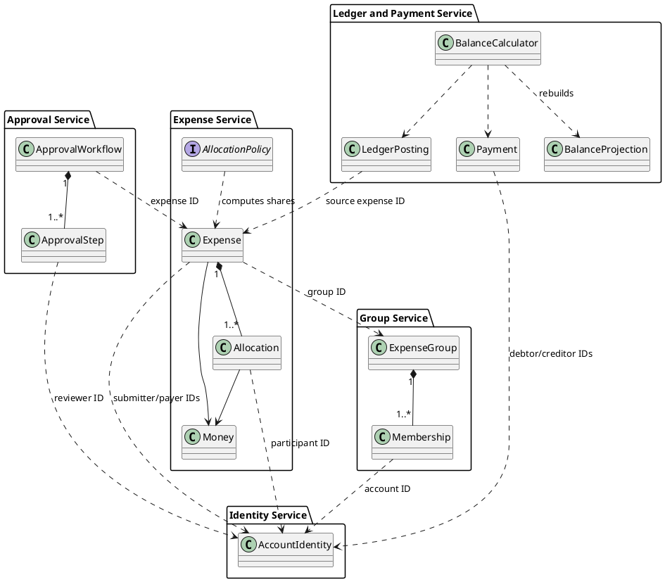

# SplitSmart Alternative Architecture Proposal

**Status: NOT SELECTED for the current implementation.** The project has adopted [`base-architecture.md`](base-architecture.md): a layered modular monolith using Ports and Adapters. This microservices design is retained as historical/future evaluation material and may be reconsidered only if future requirements justify independently deployed services. It is not the primary system architecture, an implementation plan, or evidence that these services exist. The feature spec remains Draft and its open product questions remain unresolved.

> **Decision boundary:** Do not introduce the service decomposition, API gateway, message broker, independently deployed services, or service-owned databases described below into the initial implementation. The current design is documented in [`design-and-traceability.md`](design-and-traceability.md) and [`diagrams/`](diagrams/).

## 1. Purpose and architecture choice

The base architecture uses a layered application with ports and adapters. This alternative separates the server side into independently deployable Java services that communicate over versioned HTTP APIs and asynchronous events. The Swing application is a client of those APIs, not a place where authoritative business rules live.

This design is aimed at the complete product: primary web, Android, and iOS clients, with an optional Swing desktop client for the candidate MVP. A Java Swing application alone does not satisfy CR-010. All clients use the same server-side services and see the same authorized records.

Microservices add deployment, network, observability, and data-consistency costs. The project spec proposes a planning load of 100 concurrent active users; that target alone does not establish a need for microservices. Treat this as a future-scale alternative. For a course MVP, the same service boundaries can run as separate Maven modules in one deployable process, with extraction into processes only when operational needs justify it.

## 2. System context

```text
 Swing desktop client (Java 21) --\
 Web client -----------------------+--> API Gateway / edge API
 Android app ---------------------/             |
 iOS app ---------------------------------------+
                                                |
        +---------------------------------------+-----------------------+
        |               |              |         |          |            |
   Identity       Group Service  Expense Service Approval  Ledger/     Reporting
   Service                                      Service   Payment Svc   Service
        |               |              |         |          |            |
     own DB          own DB         own DB     own DB     own DB       read model
                                       \          |         /             |
                                        +--> event broker <--+             |
                                                 |                        |
                                       Notification Service <--------------+
                                                 |
                                       email/push/in-app adapters

 Expense Service --> private receipt object storage (through receipt adapter)
```

The API gateway authenticates requests, applies edge-level throttling, and routes API calls. Services still enforce authorization and validate their own operations; the gateway is not the sole security boundary. Web and mobile client technology choices are not specified by this proposal.

## 3. Service boundaries and ownership

Each service owns its schema and writes. Other services access its data through APIs or published events, never by querying its tables. A service may use a relational database such as PostgreSQL; separate schemas or databases can be used during early deployment, but ownership contracts should be preserved.

| Service | Owns and provides | Main responsibilities |
|---|---|---|
| Identity | Accounts, verified email, credential hashes, recovery and session/token lifecycle | Registration, verification, sign-in, recovery; expose stable account IDs and authentication claims. |
| Group | Groups, invitations, memberships, manager/approver configuration | Create/manage groups; only managers invite/remove; invitation acceptance; preserve historical membership references after removal. |
| Expense | Expense details, participants, allocations, receipt metadata, submission state | Validate inputs and currency precision; calculate equal/percentage shares; upload/associate optional receipts; publish submission events. |
| Approval | Approval policies and decisions/steps | Authorize reviewers; support one or multiple steps; publish an approved-for-posting event only when all required steps complete. |
| Ledger and Payment | Immutable postings and payment records; pairwise balance projection | Post approved expense obligations; validate and record partial/full settlements; reject overpayment; serve balance queries. |
| Reporting | Read-optimized report projections | Expense, balance, and payment summaries/date ranges and supported filters, scoped to requester authorization. |
| Notification | In-app notification records and delivery attempts | Notify relevant group members of submission/status changes; retry delivery through selected channels. |

Keep boundaries deliberately coarse at first. Identity and notification are common cross-cutting boundaries; expense approval and group functions may be deployed together initially if team size and workload do not justify independent operations. Do not split a service solely to mirror every noun in the specification.

## 4. Maven repository and Java structure

Use a Maven reactor parent (`splitsmart-parent/pom.xml`) with Java 21 compiler release and centrally managed plugin/dependency versions. A service can contain `api`, `application`, `domain`, and `infrastructure` packages internally; this keeps business logic testable without requiring a large number of shared libraries.

```text
splitsmart-parent/
  pom.xml
  splitsmart-contracts/              # OpenAPI/event schemas, generated DTOs if useful
  splitsmart-client-desktop/         # Swing UI, REST client, desktop composition root
  splitsmart-service-identity/       # Java 21 service, own domain and storage adapter
  splitsmart-service-groups/
  splitsmart-service-expenses/
  splitsmart-service-approvals/
  splitsmart-service-ledger/
  splitsmart-service-reporting/
  splitsmart-service-notifications/
  splitsmart-api-gateway/            # Routing/auth edge configuration or Java gateway
  splitsmart-test-support/           # Test fixtures only; avoid shared domain model
```

Each service module should build a deployable artifact and own its migrations, configuration, API contract, and operational health endpoint. `splitsmart-contracts` contains transport contracts, not shared JPA entities or business logic. Avoid a shared domain jar used by every microservice: it couples service releases and encourages cross-service object graphs. The Swing client calls API DTOs and must not import server persistence or domain implementations.

The future web, Android, and iOS applications can live in separate repositories/toolchains and consume the same API contracts. Their existence and parity are product deliverables; this Java/Swing proposal does not itself implement those clients.

## 5. Main request and event flows

### Expense submission and approval

1. The client submits an expense command through the gateway with group, payer, participants, amount/currency, date, description, split method, and optional receipt reference/upload.
2. Expense Service verifies the caller and asks Group Service (or a trusted membership projection) whether the caller and payer are current group members. It validates allocation inputs and calculates exact shares using `BigDecimal` and currency precision.
3. In one local transaction, Expense Service saves the pending expense and an outbox event. An event relay publishes `ExpenseSubmitted`.
4. Approval Service creates the required review steps and emits `ApprovalStatusChanged` events. Notification Service records and delivers notices to the relevant group members.
5. When all configured approval steps complete, Approval Service emits an idempotent `ExpenseApprovedForPosting` event. Ledger Service consumes it, verifies the expense/event identity and amount, and records ledger postings exactly once. Pending/rejected expenses never create postings.
6. Balance and report projections consume ledger/payment events and update their read models. Clients query current status and balances through authorized endpoints.

### Payment and balance update

1. The debtor requests a payment from Ledger/Payment Service with creditor, amount, and date.
2. In one transaction, the service locks or version-checks the relevant obligation, calculates the current outstanding amount, rejects any payment above it, records the payment and its outbox event, and updates/rebuilds its balance projection.
3. Reporting and notification consumers process `PaymentRecorded`. A retry with the same idempotency key returns the original result rather than applying the payment twice.

### Distributed workflow safeguards

There is no cross-service database transaction. Use transactional outboxes for state changes that publish events, inbox/deduplication records for consumers, stable event IDs, idempotent handlers, and retry/dead-letter handling. Approval-to-ledger posting is eventually consistent: the approval status and balance projection may update at different times, but the ledger must reject duplicate postings and the UI should display processing status. Monitor event lag to support the spec's proposed cross-client convergence target of five seconds.

## 6. Domain class view

This simplified diagram shows ownership and boundaries. Transport DTOs and persistence records are intentionally distinct from domain classes.



Services exchange stable IDs and explicit messages. They do not hold live object references across service boundaries. The canonical account email and credential data remain in Identity; other services retain only the account IDs and display data needed for their use cases, with clear rules for refreshing cached profile information.

## 7. Monetary correctness with `BigDecimal`

Use `BigDecimal` for all amount, percentage, and intermediate calculation values in Java. Never convert money through `double` or `float`. A `Money` value includes currency code and scale policy; reject non-positive expense values and values with excess fractional digits before persistence. Percentages must be nonnegative and total exactly 100% at the defined input precision.

For split calculations, calculate each unrounded share at sufficient decimal precision, convert to minor units using the largest fractional remainder algorithm, and resolve equal remainders in the participant order shown to the submitter. Assert that allocated shares sum exactly to the expense amount. Keep the rounding algorithm versioned in the Expense Service so historical allocations are not recomputed under changed rules.

Serialize amounts in APIs and events as decimal strings plus currency metadata, for example `{ "amount": "12.34", "currency": "USD" }`; do not use JSON binary floating-point numbers. Persist amounts using exact database `DECIMAL/NUMERIC` or integer minor units with currency and scale metadata. Select one-group-one-currency for the initial scope as the spec assumes; mixed currency remains an open question.

## 8. Storage, consistency, and security

- **Per-service data stores:** Use relational stores for transactional account, group, expense, approval, and ledger data. Reporting may use a separate read-optimized relational schema or analytical store, fed by events. Each service owns migrations and backups.
- **Ledger:** Record immutable expense-posting and payment events with source IDs, group/currency, debit/credit parties, exact amount, and timestamps. Build pairwise balances from ledger activity. A balance projection is rebuildable and cannot replace the audit record.
- **Receipts:** Store image bytes in private object storage under opaque keys; save metadata in Expense Service. Restrict upload/download via server authorization, validate content and size, and avoid placing receipt bytes in SQL or notification messages.
- **Identity and access:** Use verified unique email and password recovery as specified; store only a modern password hash. Validate group membership/role for every service operation that reads or changes protected data. Removed members lose future access while historical references remain; pending expenses remain actionable by active approvers.
- **API and events:** Version external APIs and event schemas. Use TLS, short-lived credentials, secrets management, and audit sensitive actions. Do not log passwords, recovery secrets, receipt contents, or unnecessary personal data.
- **Notifications:** Persist notification intent via an outbox event; delivery channel, retries, and read receipts remain product decisions. A failed external delivery must not roll back a saved expense.
- **Operations:** Add health/readiness checks, structured logs with correlation IDs, event lag metrics, tracing across gateway/services, backup/restore procedures, and deployment configuration. The spec's 99.5% availability and latency figures are proposed targets and require confirmation before being treated as service objectives.

## 9. Swing presentation and business logic separation

```text
Swing screens (JFrame/JPanel)
      |
Swing controllers/presenters
      | command/query DTOs; async HTTP calls
      v
Typed REST client + session/token handling
      |
API Gateway --> Java service APIs
                  | application use cases
                  | domain rules (BigDecimal)
                  | repositories and event outbox
                  v
               owned storage
```

Swing handlers gather input, call an application-facing REST client, and render responses. They may provide immediate input feedback but do not determine the authoritative split, approval outcome, payment limit, authorization, or balance. Business validation lives in the owning service and is repeated at the API boundary. Network calls run off the Swing event dispatch thread; UI updates return on that thread. Translate typed API errors into useful messages without embedding policy in dialogs.

The Java desktop MVP can use a local service deployment for demonstration, but it should call the same service API contracts planned for remote hosting. A local SQLite-only desktop mode is a separate deployment choice and cannot provide shared cross-client consistency without synchronization design.

## 10. Test strategy

Use JUnit 5 for Java unit, component, and service tests. Test `BigDecimal` invariants in the owning service: equal/percentage allocations, precision validation, largest-remainder ordering, payer outside participant set, approval gating, duplicate event handling, ledger posting idempotency, partial/full payments, and overpayment rejection. Use service-level tests with disposable databases for constraints, transactions, migrations, and outbox/inbox behavior.

Add API contract tests for clients and service consumers, event-schema compatibility checks, authorization tests for non-members/removed members, and end-to-end flows across submission, approval, ledger posting, and balance reads. Test failure/retry paths and convergence within the proposed five-second target. Swing tests cover client rendering and interaction; they do not substitute for server-side rule tests.

## 11. Requirement coverage and scope boundaries

| Requirement area | Service/API support | Acceptance scenarios to trace |
|---|---|---|
| Accounts and groups, invitations/access (CR-001–002) | Identity and Group Services | AS-001–003, AS-024, AS-027 |
| Expense data, participants, split rules, receipt (CR-003–004) | Expense Service and private receipt storage | AS-004–006, AS-022–026 |
| Notifications and review (CR-005–006) | Notification and Approval Services, outbox/events | AS-007–012, AS-024 |
| Pairwise balances and payments (CR-007–008) | Ledger/Payment Service | AS-010, AS-013–015, AS-023 |
| Reports and date filters (CR-009) | Reporting Service/read models | AS-016–018 |
| Web, Android, iOS and client consistency (CR-010) | Shared authenticated API; distinct product clients | AS-019–021 |

The Swing candidate MVP described in the spec includes only selected account/group/expense/single-step approval/balance capabilities. Receipts, notifications, multi-level approval, payments, reports, and primary web/Android/iOS delivery are deferred from that candidate but remain full product requirements. This proposal does not mark those requirements complete.

## 12. Trade-offs and adoption path

**Benefits:** Services have explicit ownership, can scale independently, isolate failures, and allow separate release cycles. The ledger, approval, and notification flows can evolve behind stable APIs and events while multiple clients share a common server boundary.

**Costs:** Network failures, eventual consistency, distributed debugging, event replay, service deployment, and duplicated operational setup increase complexity. Cross-service report queries and access checks require carefully maintained projections. These costs may outweigh the benefits at the specified planning scale.

**Practical adoption:** First preserve these service boundaries as Java packages/Maven modules and run them in one process with one deployment. Establish API/event contracts, owned schemas, idempotency, and tests. Extract a service into its own process/database only when independent scaling, team ownership, reliability, or release cadence provides a concrete reason. Prioritize an authenticated shared API and web/mobile delivery for CR-010; do not let a Swing desktop milestone be presented as satisfying the whole platform requirement.

Before implementation planning, resolve the spec's open questions: currency support, notification channels/delivery expectations, approver permissions and self-approval, approval policy changes, desktop MVP relationship and platform release order/parity, report filters and payment corrections, and approved service targets. Human review is required before accepting this AI-generated proposal.
