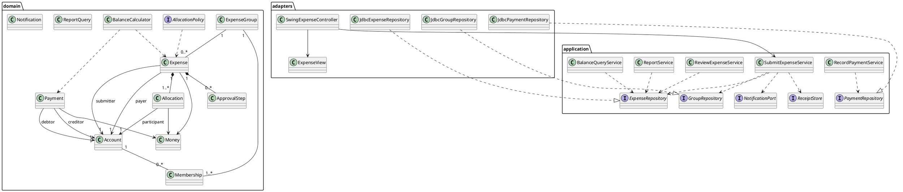

# SplitSmart Base System Architecture

**Status:** Initial architecture proposal derived from `UserRequirement.md`, `specs/001-expense-sharing/spec.md`, and the project constitution. The feature specification is a draft; open product questions listed there remain unresolved. This document is a design baseline, not evidence that any feature is implemented.

## 1. Goals and scope

SplitSmart tracks shared expenses, approvals, pairwise obligations, settlement payments, notifications, and reports for individual accounts and groups. The architecture separates UI, use-case coordination, business rules, and storage so the rules can be exercised without Swing.

The requested Java 21, Maven, Swing, JUnit 5, object-oriented design, PlantUML, and `BigDecimal` are implementation constraints. The customer also requires a primarily web-based product and Android and iOS apps. Swing is suitable for the proposed desktop MVP only and does not satisfy those platform requirements. The complete product therefore needs web and mobile clients connected to shared server-side services. The server/API and non-desktop client technologies are not specified here and need product/technology decisions.

The initial desktop MVP candidate covers account access, groups, expense entry/allocation, single-step review, and balances. Receipt images, notifications, multi-level approval configuration, payments, reports, and web/mobile delivery remain in the full product scope; they are not implied to be delivered by the desktop MVP.

## 2. Architectural style and boundaries

Use a layered, ports-and-adapters design. The domain owns invariants and calculations; application services implement use cases and coordinate ports; adapters implement persistence, notification delivery, and client interfaces. Dependencies point inward: Swing and storage depend on application/domain contracts, while domain code has no dependency on Swing, JDBC, or a database vendor.

```text
Desktop MVP
  Swing views/controllers -> application use cases -> domain model
                                              |          |
                                              v          v
                                      repository ports  pure rules
                                              |
                                      SQLite/JDBC adapter

Complete product (target boundary)
  Web client ----\
  Android app ----+--> authenticated API --> same application/domain rules
  iOS app --------/                              |
  Swing client (optional)                         +--> shared persistent store
                                                  +--> notification adapter
                                                  +--> receipt object storage
```

The desktop MVP can invoke application services in-process and persist locally. For multi-device consistency, shared access control, and cross-client convergence, the complete product needs a server as the authoritative application boundary; clients should not connect directly to the production database. Expose use cases through a versioned API and reuse domain/application code where deployment and client language permit. If the web/mobile stacks cannot run the Java application layer directly, keep the API as the sole policy boundary and use contract/integration tests to protect behavior.

## 3. Proposed Maven module structure

Use a Maven parent at the repository root (`pom.xml`) with Java release 21 and centrally managed dependency/plugin versions. The module split is a starting point; it can be collapsed for a small course MVP while retaining package-level boundaries.

```text
splitsmart-parent/
  pom.xml
  splitsmart-domain/             # Entities/value objects and business rules; no UI/database framework
  splitsmart-application/        # Use cases, DTOs, ports, authorization decisions
  splitsmart-adapter-persistence/# JDBC repositories, schema migration, transaction boundary
  splitsmart-adapter-notification/# In-app/email/push adapters as channels are decided
  splitsmart-adapter-receipt/    # Receipt metadata and binary storage adapter
  splitsmart-desktop/            # Java Swing UI and composition root for desktop MVP
  splitsmart-server/             # Future authenticated API and server composition root
  splitsmart-contracts/          # Optional API schemas/shared serialization contracts
```

Dependency direction: `domain` is standalone; `application` depends on `domain`; adapters depend on `application` and `domain`; `desktop` depends on `application` and adapter implementations; `server` depends on `application` and server-side adapters. Desktop and server are separate composition roots and must not depend on each other. A future web client and Android/iOS apps are independent clients of the server API, not Maven modules unless their chosen toolchains warrant inclusion in the repository.

Suggested package areas inside the domain/application: `account`, `group`, `expense`, `approval`, `balance`, `payment`, `notification`, and `report`. Keep authorization checks in application use cases and enforce data scoping in repository queries as defense in depth.

## 4. Responsibilities and class design

### Domain

- `Account`, `ExpenseGroup`, and `Membership` model identity and group access state. Store a password hash, never a raw password; email verification and recovery are account/authentication workflows.
- `Expense` records submitter, exactly one payer, amount, currency, date, description, allocation method, participants/allocations, receipt reference, and review state. The payer is a group member and can be outside the participant list.
- `AllocationPolicy` calculates equal or percentage shares. Validate positive amounts and currency precision; percentages must be nonnegative and total exactly 100%. Use `BigDecimal` throughout. Resolve minor-unit remainders by largest fractional remainder, then displayed participant order; resulting shares must sum exactly to the expense total.
- `ApprovalPolicy`/`ApprovalStep` represent configured review requirements. Pending or rejected expenses have no balance effect; posting is enabled only when all required steps are approved.
- `BalanceCalculator` derives pairwise obligations from approved expenses and settled payments. A payer is credited for the full expense while allocations identify each participant's share. Do not treat a materialized balance as the authoritative ledger.
- `Payment` captures debtor, creditor, amount, and date. Reject a payment above the current amount owed; support partial and full settlement.
- Use immutable value objects where practical: `Money` (amount plus currency), `EmailAddress`, `ExpenseId`, `GroupId`, and `DateRange`. `Money` wraps `BigDecimal` and applies explicit scale/rounding at currency boundaries.

### Application

Use case services expose operations such as `RegisterAccount`, `CreateGroup`, `InviteMember`, `SubmitExpense`, `ReviewExpense`, `GetBalances`, `RecordPayment`, and `GenerateReport`. Each operation authenticates/authorizes the actor, loads aggregates through repository interfaces, invokes domain behavior, and commits changes through a unit-of-work/transaction port. Publish domain events after commit for notifications and other side effects. Keep Swing event handlers thin: collect input, call a use case, render its result; they must not calculate splits, approvals, or balances.

### Adapters and presentation

Swing screens and controllers live in `splitsmart-desktop`. They use application request/response models and an injected service facade; they do not issue SQL. JDBC adapters map persistence records to domain objects. A notification adapter can initially persist in-app notifications; email/push delivery is a replaceable adapter once channels are confirmed. Receipt storage uses a port so local development can use a controlled local directory and a hosted deployment can use object storage.

## 5. Class diagram (PlantUML)



The diagram is conceptual: supporting DTOs, authentication/session components, invitation state, report result types, transaction ports, and database migration classes are omitted for readability. Keep the PlantUML source synchronized with implementation as modules evolve.

## 6. Storage and transaction strategy

### Desktop MVP

Use SQLite through JDBC for a single-user/local desktop demonstration, with schema migrations and foreign keys enabled. Store normalized records for accounts, groups, memberships/invitations, expenses, allocations, approval steps, payments, and notifications. Persist money as fixed-scale decimal text or an exact integer number of minor currency units plus currency metadata; never use SQL floating-point for money. Define currency precision explicitly. Wrap each use case that changes related records in one database transaction.

Store receipt bytes outside relational rows, under generated opaque identifiers; persist metadata (identifier, content type, size, checksum, owning expense) in the database. Validate file type/size and authorization when attaching or retrieving. Back up the database and receipt directory together. Local storage is not a shared multi-client production strategy.

### Complete multi-client product

Use a server-managed relational database (for example PostgreSQL) behind the authenticated API. The database is authoritative; transactions atomically save expense, allocations, approval state, payments, and any balance/ledger entries. Preserve an auditable ledger of approved expense postings and payment events. Derive balances from that ledger or maintain a rebuildable balance projection updated in the same transaction. Use optimistic versioning or equivalent concurrency control for reviews and payments to prevent duplicate approval/posting or overpayment under concurrent requests.

Store receipt images in private object storage and reference them by opaque key. Enforce access through server authorization and short-lived access URLs or a streaming endpoint. Do not store image blobs in the core relational tables. Persist notification records in the database/outbox in the same transaction as the triggering event; a worker delivers external email/push notifications and retries failures. This avoids losing notices between commit and delivery. Channel and delivery guarantees remain open specification questions.

Use database constraints for uniqueness and referential integrity (including normalized unique verified email), application/domain validation for business rules, and scoped reads for group membership. Passwords must be stored using a modern password hashing scheme; credentials, recovery tokens, receipt content, and personal records must not be logged. Confirm deployment, retention, encryption, and backup requirements before production.

## 7. GUI and business logic separation

```text
Swing JFrame/JPanel
      | user intent + view state
      v
Swing controller/presenter
      | application command/query DTOs
      v
Application use case service
      | invokes
      v
Domain objects and policies
      | repository/transaction interfaces
      v
Persistence and external-service adapters
```

Swing components may validate simple input shape for immediate feedback, but the application/domain layer repeats all authoritative validation. No domain class imports `javax.swing`; no controller implements allocation, approval, payment, or balance rules. Return typed outcomes/errors to the UI rather than showing dialogs from business services. This allows JUnit 5 tests to instantiate domain and application services without a display or Swing event loop.

## 8. Test architecture

Use JUnit 5 in the relevant Maven modules. Domain tests cover equal/percentage allocation, currency precision, largest-remainder tie breaking, payer distinct from participants, approval gating, pairwise balance derivation, and payment bounds. Application tests use in-memory repository/notification/receipt fakes to cover authorization, transaction outcomes, status transitions, and use-case orchestration. Persistence adapter tests verify migrations, constraints, mappings, and transaction rollback against a disposable test database. UI tests should be limited to key navigation/form behavior; do not make GUI tests the only verification of business rules. Add API contract and cross-client consistency checks when the server and other clients are introduced.

Tests are prescribed by the project constitution/spec; no tests are run as part of producing this architecture document.

## 9. Requirement coverage and unresolved decisions

| Area | Architectural support | Scope note |
|---|---|---|
| Accounts and groups (CR-001–002) | Account/group domain, auth and membership use cases, scoped repositories | Email verification/recovery provider and account lifecycle details need implementation planning. |
| Expenses, splits, receipts (CR-003–004) | Expense aggregate, allocation policy, receipt port | Desktop MVP may defer receipt UI/storage per spec. |
| Notifications and approvals (CR-005–006) | Approval state machine, notification outbox/adapter | Channels, approver permissions, and policy changes remain open. |
| Balances and payments (CR-007–008) | Ledger-derived pairwise balances; payment transaction and bounds | Payments are deferred from proposed desktop MVP, not removed from product scope. |
| Reports (CR-009) | Query/report service over authorized records | Required filters beyond date range remain open. |
| Platforms (CR-010) | Shared server/API boundary for web, Android, iOS clients | Swing alone is explicitly insufficient; roadmap and parity remain open. |

Before production planning, resolve the specification's open questions: supported currencies/mixed-currency behavior, notification channels and delivery expectations, approver permissions/self-approval and policy changes, desktop MVP relationship and platform release order/parity, report parameters and payment correction workflow, and approved service objectives. The proposed performance and availability figures are planning baselines, not customer commitments.

## 10. Initial implementation sequence

1. Establish the Maven parent and domain/application module boundaries, Java 21 configuration, and JUnit 5 dependency management.
2. Implement exact money and allocation policies, then account/group membership and authorization use cases.
3. Add expense submission, single-step approval, and ledger-based balance queries for the Swing MVP.
4. Add storage adapters/migrations and the Swing screens as a thin client of use cases.
5. Extend with multi-step approvals, notifications, payments, reports, and receipt handling according to approved scope.
6. Design and deliver the authenticated server/API and web, Android, and iOS clients to satisfy CR-010; validate shared records and permissions across clients.

Each step should retain traceability to the CR/FR/AS identifiers in `specs/001-expense-sharing/spec.md` and receive human review as required by the constitution.
